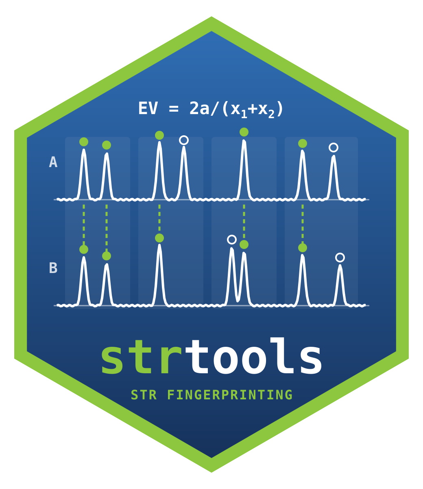

# strtools 

Tools for the analysis of STR (short tandem repeat) DNA fingerprinting
data of cell lines.

This R package contains the code used in:

> Bady P, Diserens AC, Castella V, Kalt S, Heinimann K, Hamou MF,
> Delorenzi M, Hegi ME (2012). DNA fingerprinting of glioma cell lines
> and considerations on similarity measurements. *Neuro-Oncology*,
> 14(6), 701-711. [doi:10.1093/neuonc/nos072](https://doi.org/10.1093/neuonc/nos072)

The code dates from 2011. Version 1.0.1 only fixes what was needed to
run under current R and ade4, and completes the documentation (see
[NEWS.md](trunk/strtools/NEWS.md)).

## Repository structure

```
strtools/
├── LICENSE
├── README.md
├── logo/                       hexagonal logo (SVG, PNG)
└── trunk/
    ├── strtools/               R package source (DESCRIPTION, R/, man/, data/)
    ├── Rpackage/               source tarball strtools_1.0.1.tar.gz
    └── documentation/          reference manual (strtools-manual.pdf)
```

## Installation

From GitHub (the package is in the `trunk/strtools` subfolder):

```r
# install.packages("remotes")
remotes::install_github("badozor/strtools", subdir = "trunk/strtools")
```

From the source tarball, after downloading
[`trunk/Rpackage/strtools_1.0.1.tar.gz`](trunk/Rpackage/strtools_1.0.1.tar.gz):

```r
install.packages("strtools_1.0.1.tar.gz", repos = NULL, type = "source")
```

`strtools` depends on [ade4](https://cran.r-project.org/package=ade4).

## Documentation

The reference manual is available as a PDF:
[`trunk/documentation/strtools-manual.pdf`](trunk/documentation/strtools-manual.pdf).

## Main functions

| Function | Purpose |
|---|---|
| `recode.STR2col()`, `recode.STR1col()` | recode allele calls into an allele table (`genocell` object) |
| `EVindex()` | Masters (EV) similarity score between profiles |
| `heterozygosity()` | homozygous / heterozygous profiles by marker |
| `merge()` | combine two `genocell` objects on their common markers |
| `genocell2tab()` | convert a `genocell` object back to allele calls |
| `prep.fuzzy.genocell()` | fuzzy coding for ade4 multivariate analyses |
| `simSIM.marker()`, `simSIM2.marker()`, ... | simulate similarity scores between unrelated profiles |
| `simAIJ.marker()`, `simAIJ.peak()` | simulate the number of shared alleles |
| `REspaceout()`, `REbracketout()`, `REzeroout()` | clean raw allele calls |

Data sets: `GliomaCL` (16 marker STR profiles of 39 glioma cell lines,
Bady et al. 2012) and `NCI60` (16 marker STR profiles of 62 NCI-60
cell lines).

## Example

```r
library(strtools)
data(GliomaCL)

gcl <- recode.STR2col(GliomaCL$tab, GliomaCL$bloc, method = "binary")
heterozygosity(gcl)

ev <- EVindex(gcl)
w <- as.matrix(ev)
w[upper.tri(w, diag = TRUE)] <- NA
which(w >= 0.8, arr.ind = TRUE)   # pairs above the usual 0.8 cutoff

# EV scores between unrelated profiles, 9 versus 16 markers
quantile(simSIM.marker(marker = 9,  R = 999), 0.99)
quantile(simSIM.marker(marker = 16, R = 999), 0.99)
```

## Citation

```r
citation("strtools")
```

## License

GPL-3. See [LICENSE](LICENSE).
